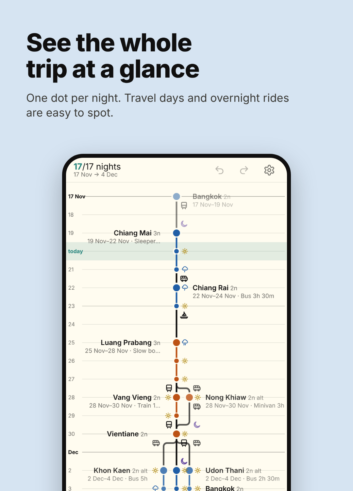
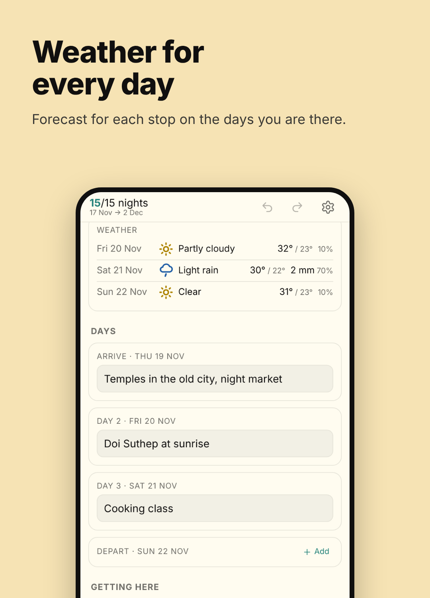
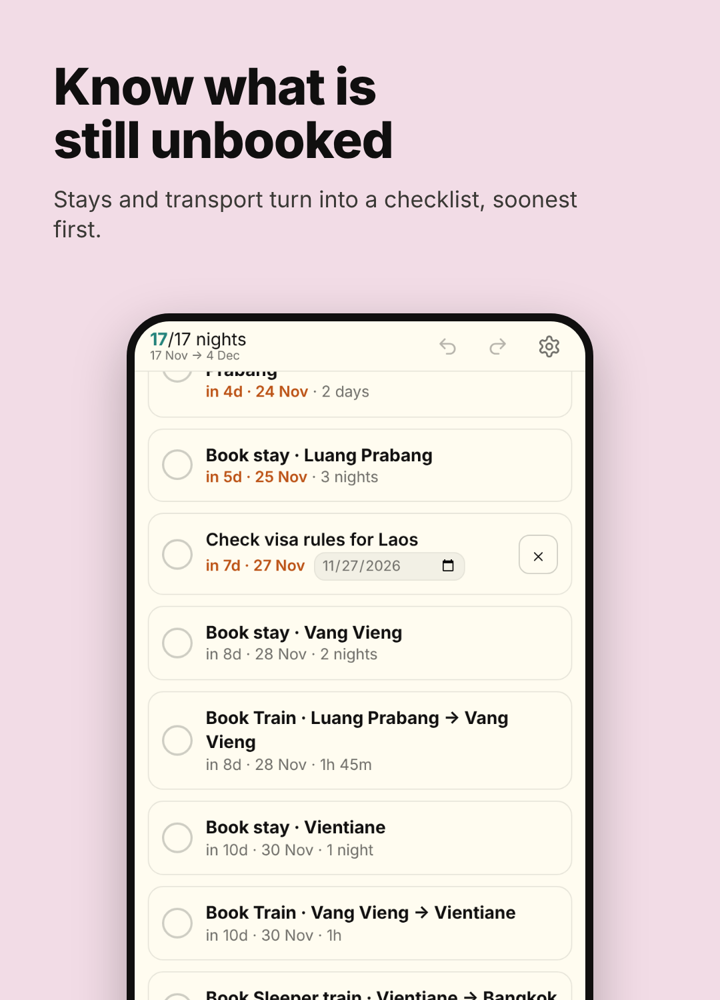
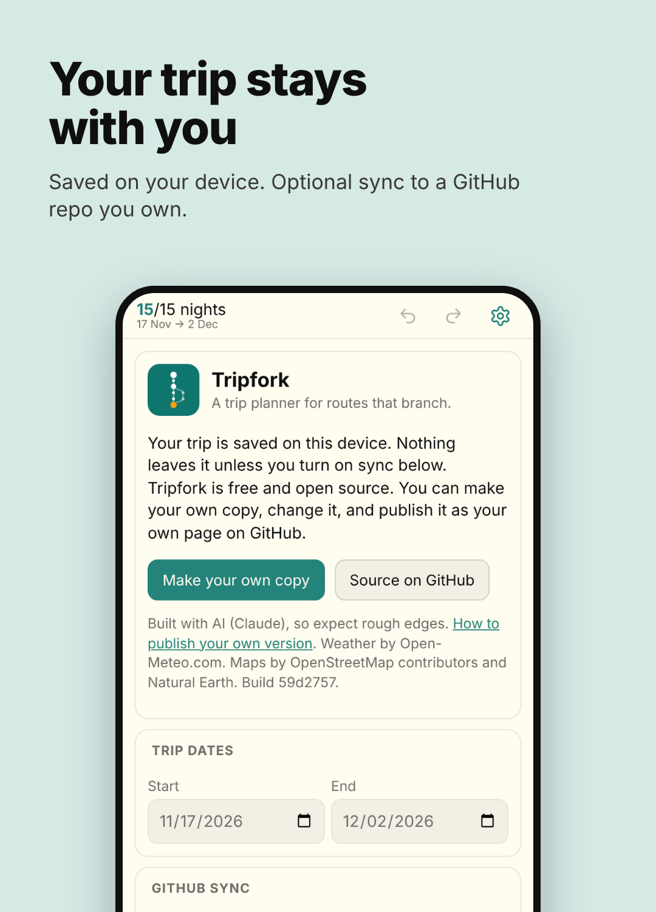

<p align="center"></p>

# Go Find Yourself

A trip planner for routes that branch. Add the stops, set the nights, pick how you travel between them. Keep two routes open until you decide which one to take.

**[Open the app](https://barton-muller.github.io/find-your-self/)** &nbsp;·&nbsp; [Install it on your phone](#install-on-your-phone) &nbsp;·&nbsp; [Keep your trips in GitHub](#keep-your-trips-in-github) &nbsp;·&nbsp; [Source](https://github.com/barton-muller/find-your-self)

Free and open source: go ahead and [clone or fork it](docs/MAKE-YOUR-OWN.md).

<p align="center">



</p>
<p align="center">



</p>

## Install on your phone

It is a web app. Install it from the browser and it opens like any other app, and works without a connection.

- **iPhone or iPad:** open the app in Safari, tap *Share*, then *Add to Home Screen*.
- **Android:** open the app in Chrome, open the menu, then *Install app*.
- **Computer:** it works in any current browser.

## Keep your trips in GitHub

There are no accounts and no server. Your trips are saved in your browser, on your device. Browsers can delete stored data, and iOS does so for sites you have not used for a while. So the app can also save every trip to a **private GitHub repo that you own**. It is optional, and it is the best way to keep your trips safe.

- **Safe and in step.** Each trip is a file in your repo, `trips/<name>/plan.json`. Every device shows the same trips, and git keeps a history of every change.
- **An AI agent can edit them.** Point an agent such as Claude Code at the repo. Ask it "add two nights in Hanoi after Ninh Binh" and it edits the plan, checks the dates and saves. *Settings* has a *Copy for AI agent* button that copies the repo, branch and instructions for it.
- **Sign in with GitHub.** If the site's owner has set it up, you press a button, approve, and pick a repo from a list. No token to make by hand. ([Setup for site owners](docs/GITHUB-SIGN-IN.md))
- **Share with friends and family.** If they cannot make a GitHub token, make one in the app and send an invite link. Opening it connects their app to your repo, on a branch of their own. They need no GitHub account.

Start here: **[Sync and AI guide](docs/SYNC-AND-AI.md)** (includes how to make the token). For invite links: **[Share a trip repo](docs/FRIENDS.md)**. The folder [`data-template`](data-template) is a ready-made starter repo with the rules for agents already written.

Keep your data repo private. It holds your dates, places and booking notes. The template is public and has no personal data. Without sync, add the app to your home screen and export a backup now and then (*Settings, Backup*).

## What it does

- **Plan.** A list of stops with a number of nights each. Dates and totals update as you change anything. Insert a stop between two others, or reorder with arrows.
- **Branch.** Keep two ways to get from A to B. Pick one and see how the dates change where the routes meet again.
- **Transport.** Each connection can have several options (train, bus, flight, boat) with duration, cost and notes. Mark overnight rides and multi-day trips. Tick them off when booked.
- **Timeline.** One dot per night. Travel days are black lines with an icon. Pinch to zoom.
- **Map.** Stops and connections on OpenStreetMap. Roads follow the road, rail follows the track, flights are arcs.
- **Weather.** The forecast for each stop on the days you are there, up to 15 days ahead.
- **To-do.** Stays and transport that are not booked yet, soonest first, plus your own to-dos.
- **Notes.** For each stop and for each day.
- **Several trips.** Keep as many trips as you like, with or without sync, and switch between them in Settings.
- **Offline.** After the first visit it works without a connection.
- **Undo and redo.** Export and import your trips as a file.

## About this project

Go Find Yourself started as one person's planner for seven weeks in South East Asia. Almost all of the code was written by Claude, an AI assistant, from the author's instructions. It works for the author's own trips. It has no automated tests, so expect rough edges, and back up trips you care about.

Because of that, copying it and adding your own features is the normal way to use it. If you build something others would want, issues and pull requests are welcome.

## For developers

Vite, React 19 and TypeScript, with no UI library. It is a static site. The trip lives in IndexedDB and is saved to GitHub through the Contents API when sync is on.

[Fork the repo](https://github.com/barton-muller/find-your-self/fork), turn on GitHub Pages (*Settings, Pages, Source: GitHub Actions*), and every push to `main` publishes your own copy. Details, and what to check before many people use it: [Make your own copy](docs/MAKE-YOUR-OWN.md).

```
npm install
npm run dev        # local server
npm run build      # type-check and build into dist/
```

Where things are:

| Path | What it holds |
|---|---|
| `src/model.ts`, `src/types.ts` | The trip as a graph of stops and legs, and the date calculation |
| `src/views/` | Plan, Timeline, Map, Place (stop detail), To-do, Settings |
| `src/sync.ts`, `src/history.ts` | GitHub sync with per-record merge, undo and redo |
| `src/seed.ts` | The example trip new users see |
| `src/brand.ts` | Name, tagline and links in one place |
| `src/invite.ts`, `src/aiBrief.ts` | Invite links and the paste-able brief for AI agents |
| `data-template/` | Starter for the separate data repo |
| `scripts/screenshots.cjs` | Rebuilds the images in `docs/img/` (needs Playwright) |
| `AGENTS.md` | Architecture notes and conventions. `CLAUDE.md` links to it. |

The data model in one paragraph: a trip is a directed graph. Stops are nodes and transport legs are edges. A stop with more than one outgoing leg is a fork, and one of them is active. Dates come from walking the active path from the start. Records are never removed, only marked deleted, so syncing two devices can merge them record by record and the newest edit wins.

## Credits

- Weather and place search: [Open-Meteo.com](https://open-meteo.com/) (data under [CC BY 4.0](https://creativecommons.org/licenses/by/4.0/)).
- Map: © [OpenStreetMap](https://www.openstreetmap.org/copyright) contributors, drawn with [Leaflet](https://leafletjs.com/).
- Rail lines: [Natural Earth](https://www.naturalearthdata.com/) (public domain).
- Road routes: [OSRM](https://project-osrm.org/) public server.
- Colours: [Flexoki](https://stephango.com/flexoki).

## Licence

[MIT](LICENSE).
