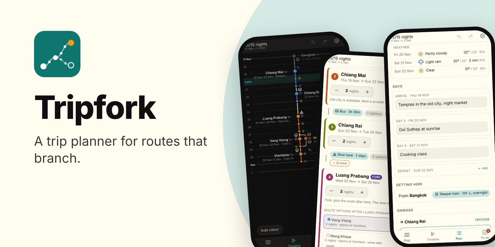
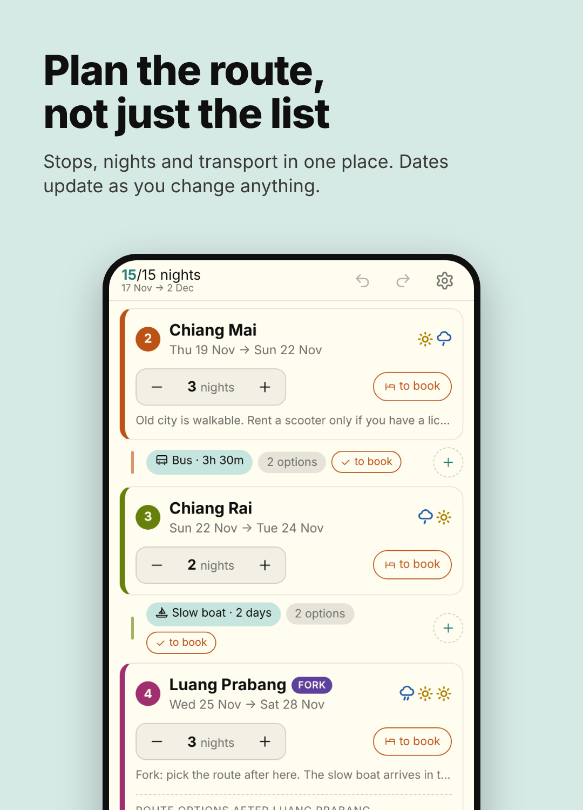
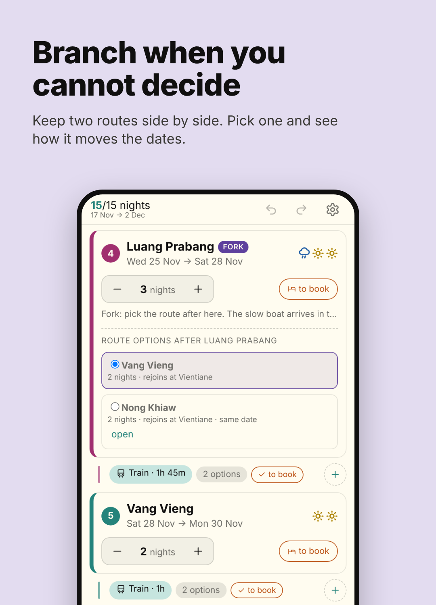
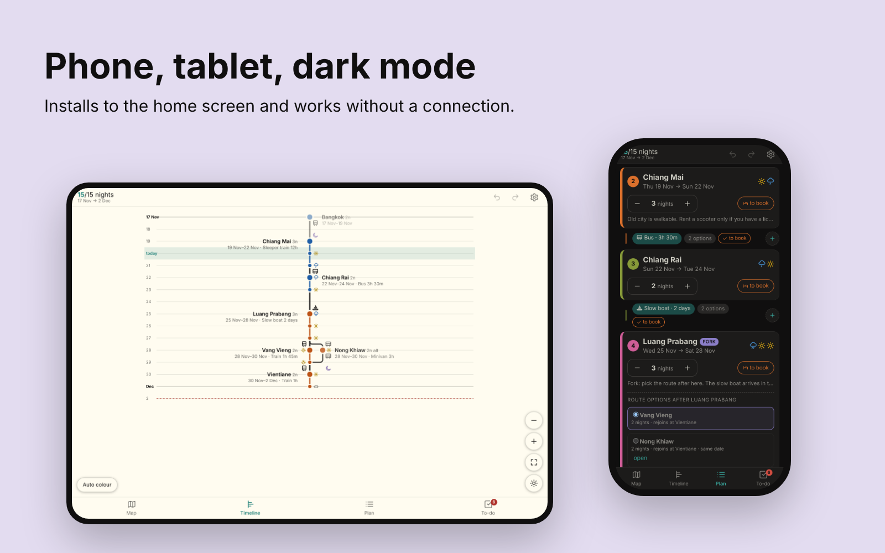

<p align="center"></p>

# Tripfork

A trip planner for routes that branch. Add the stops, set the nights, pick how you travel between them. Keep two routes open until you decide which one to take.

**[Open the app](https://barton-muller.github.io/tripfork/)** &nbsp;·&nbsp; **[Make your own copy](https://github.com/barton-muller/tripfork/fork)** &nbsp;·&nbsp; [Sync and AI guide](docs/SYNC-AND-AI.md)

Tripfork is free and open source. You can copy it, change it, and publish your own version as a GitHub page in about five minutes. [How to do that](docs/MAKE-YOUR-OWN.md).

<p align="center">



</p>
<p align="center">


</p>
<p align="center"></p>
<p align="center"><sub>The weather in these images is sample data.</sub></p>

## What it does

- **Plan.** A list of stops with a number of nights each. Dates and totals update as you change anything. Insert a stop between two others, or reorder with arrows.
- **Branch.** Keep two ways to get from A to B. Pick one and see how the dates change where the routes meet again.
- **Transport.** Each connection can have several options (train, bus, flight, boat) with duration, cost and notes. Mark overnight rides and multi-day trips. Tick them off when booked.
- **Timeline.** One dot per night. Travel days are black lines with an icon. Pinch to zoom.
- **Map.** Stops and connections on OpenStreetMap. Roads follow the road, rail follows the track, flights are arcs.
- **Weather.** The forecast for each stop on the days you are there, up to 15 days ahead.
- **To-do.** Stays and transport that are not booked yet, soonest first, plus your own to-dos.
- **Notes.** For each stop and for each day.
- **Offline.** After the first visit it works without a connection. Install it to your home screen.
- **Undo and redo.** Export and import your trip as a file.

## Your data

Tripfork has no accounts and no server. Your trip is saved in your browser, on your device. Nothing is sent anywhere unless you turn on sync.

Browsers can delete stored data, and iOS does so for sites you have not used for a while. Add the app to your home screen, and either turn on sync or export a backup now and then (*Settings, Backup*).

## Keep your trip in a GitHub repo, and let an AI edit it

Optional. You make a private GitHub repo, give the app a token that can only write to that repo, and the app saves the trip there as a file called `plan.json`. Every device with the token shows the same trip, and you get a history of every change.

The same repo can be handed to an AI agent such as Claude Code. Ask it "add two nights in Hanoi after Ninh Binh" and it edits the plan, checks the dates, and saves. The folder [`data-template`](data-template) is a ready-made starter repo with the rules for agents already written.

Step by step, including how to create the token: **[Sync and AI guide](docs/SYNC-AND-AI.md)**.

Keep your own data repo private. It holds your dates, places and booking notes. The template is public and has no personal data.

## Install on your phone

- **iPhone or iPad:** open the app in Safari, tap *Share*, then *Add to Home Screen*.
- **Android:** open the app in Chrome, open the menu, then *Install app*.
- **Computer:** it works in any current browser.

## Make your own copy

1. [Fork the repo](https://github.com/barton-muller/tripfork/fork).
2. In your fork, *Settings, Pages, Source*: choose *GitHub Actions*.
3. Open the *Actions* tab, enable workflows, and run *Deploy*.
4. Your site is at `https://YOUR-USERNAME.github.io/REPO-NAME/`.

Then change what you like, by hand or with an AI coding agent. Every push to `main` publishes again. More detail, including what to check before many people use your copy: [Make your own copy](docs/MAKE-YOUR-OWN.md).

## About this project

Tripfork started as one person's planner for seven weeks in South East Asia. Almost all of the code was written by Claude, an AI assistant, from the author's instructions. It works for the author's own trips. It has no automated tests, so expect rough edges, and back up trips you care about.

Because of that, copying it and adding your own features is the normal way to use it. If you build something others would want, issues and pull requests are welcome.

## For developers

Vite, React 19 and TypeScript, with no UI library. It is a static site. The trip lives in IndexedDB and is saved to GitHub through the Contents API when sync is on.

```
npm install
npm run dev        # local server
npm run build      # type-check and build into dist/
```

Where things are:

| Path | What it holds |
|---|---|
| `src/model.ts`, `src/types.ts` | The trip as a graph of stops and legs, and the date calculation |
| `src/views/` | Plan, Timeline, Map, Place (stop detail), To-do, Settings |
| `src/sync.ts`, `src/history.ts` | GitHub sync with per-record merge, undo and redo |
| `src/seed.ts` | The example trip new users see |
| `src/brand.ts` | Name, tagline and links in one place |
| `data-template/` | Starter for the separate data repo |
| `scripts/screenshots.cjs` | Rebuilds the images in `docs/img/` (needs Playwright) |
| `AGENTS.md` | Architecture notes and conventions. `CLAUDE.md` links to it. |

The data model in one paragraph: a trip is a directed graph. Stops are nodes and transport legs are edges. A stop with more than one outgoing leg is a fork, and one of them is active. Dates come from walking the active path from the start. Records are never removed, only marked deleted, so syncing two devices can merge them record by record and the newest edit wins.

## Credits

- Weather and place search: [Open-Meteo.com](https://open-meteo.com/) (data under [CC BY 4.0](https://creativecommons.org/licenses/by/4.0/)).
- Map: © [OpenStreetMap](https://www.openstreetmap.org/copyright) contributors, drawn with [Leaflet](https://leafletjs.com/).
- Rail lines: [Natural Earth](https://www.naturalearthdata.com/) (public domain).
- Road routes: [OSRM](https://project-osrm.org/) public server.
- Colours: [Flexoki](https://stephango.com/flexoki).

## Licence

[MIT](LICENSE).
